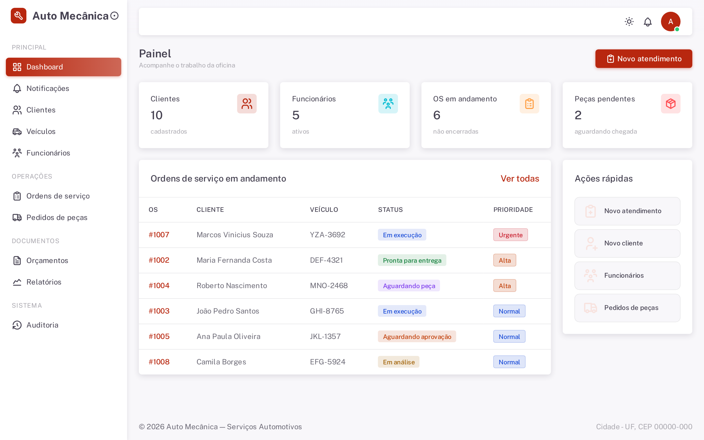
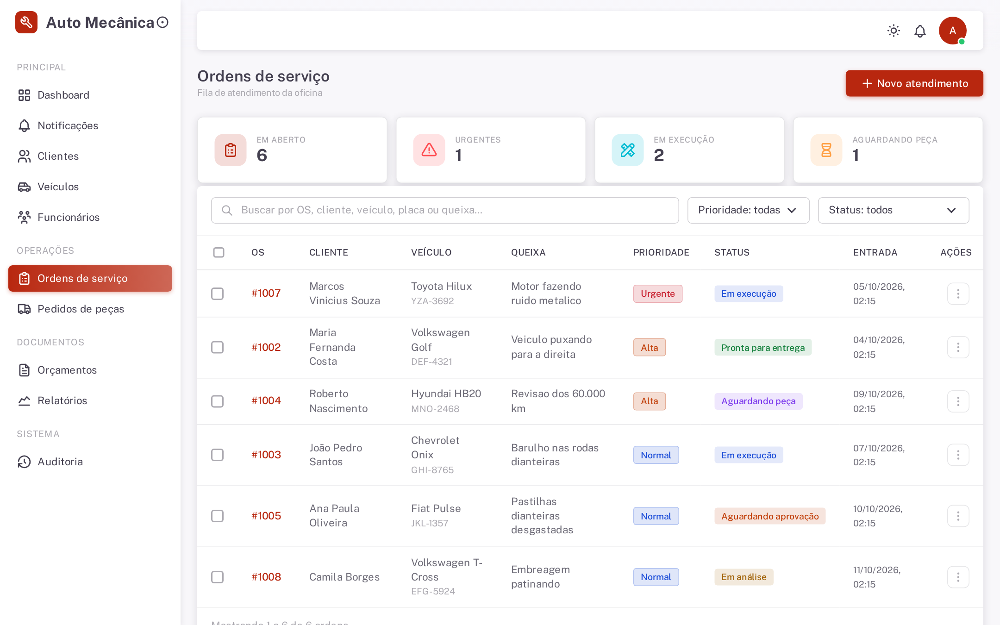
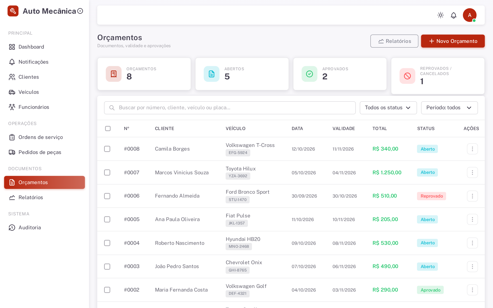
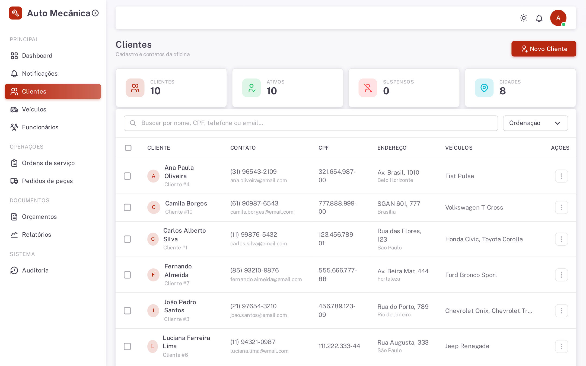

<div align="center">

# Auto Mecânica

**Sistema web de gestão para oficinas mecânicas — da recepção do veículo à entrega.**

[](https://www.php.net/)
[](https://www.mysql.com/)
[](https://getbootstrap.com/)
[](https://www.docker.com/)
[](LICENSE)

[Visão geral](#visão-geral) · [Funcionalidades](#funcionalidades) · [Como rodar](#como-rodar) · [Segurança](#segurança) · [Documentação](#documentação)

</div>

---

## Visão geral

O **Auto Mecânica** é um sistema interno para operação de uma oficina mecânica. Foi
desenvolvido como **Projeto Integrador (PI)** e cobre o atendimento completo: cadastro
de clientes e veículos, abertura e acompanhamento de ordens de serviço, solicitação e
recebimento de peças, orçamentos, entrega do veículo, notificações e auditoria.

A **Ordem de Serviço (OS)** é o centro do domínio. Clientes, veículos, tarefas,
responsáveis, peças, orçamentos, notificações e histórico se conectam à OS sempre que
fizerem parte de um atendimento.

> **Ambiente de demonstração:** o banco em `sql/mecanica.sql` já vem com dados fictícios
> e cinco logins de teste (senha `admin123`). Troque as senhas e remova os dados de
> exemplo antes de expor o sistema publicamente.

## Preview

| Login | Dashboard |
| --- | --- |
|  |  |

| Ordens de serviço | Detalhe da OS (tema escuro) |
| --- | --- |
|  |  |

| Orçamentos | Clientes |
| --- | --- |
|  |  |

---

## Funcionalidades

### Atendimento e operação

- **Dashboard por perfil** com KPIs e fila de OS, filtrado conforme o papel do usuário.
- **Clientes e veículos** com histórico de atendimentos, validação de CPF/placa/ano,
  importação de endereço via **ViaCEP** e catálogo **FIPE** (marca, modelo e valor de
  referência).
- **Ordens de serviço** com wizard de abertura, diagnóstico, tarefas, múltiplos
  responsáveis, prioridade, histórico de status e entrega/retirada do veículo.
- **Pedidos de peças** vinculados à OS, com validação, compra, acompanhamento e
  **recebimento parcial por item**.
- **Orçamentos** com itens de peça e mão de obra digitados manualmente, impressão e
  relatório.
- **Notificações** internas com sino, contador, atualização periódica (30 s) e tela
  dedicada com busca, filtros e paginação.
- **Auditoria** de ações sensíveis, restrita ao administrador.
- **Perfil do usuário** para editar nome, e-mail e senha.

### Interface

- Layout responsivo com **Bootstrap 5 + tema Vuexy** e ícones Tabler.
- **Tema claro e escuro**, com preferência persistida no navegador.
- Listagens em **CRUD AJAX** com busca, filtros, paginação server-side, ações em massa,
  modais e toasts.
- Componentes acessíveis: skip link, foco visível, `aria-*` e navegação por teclado.

### Fluxo da OS

```text
recebida → em_analise → aguardando_aprovacao → aguardando_peca
         → em_execucao → pronta_para_entrega → entregue
```

`cancelada` encerra o ciclo a partir dos estados permitidos. As transições válidas ficam
em [`config/status_os.php`](config/status_os.php), fonte única consumida pelo PHP e
exposta ao JavaScript em `window.OS_STATUS`. Saltos arbitrários são bloqueados.

A OS **não pode ser marcada como `entregue` manualmente**: a entrega/retirada precisa ser
confirmada em `os_entregas`. O histórico de status é gravado automaticamente pelo trigger
`trg_os_status_historico`.

### Fluxo de peças

```text
solicitado → validado → pedido → a_caminho → recebido
```

O status `solicitado` significa que a compra **ainda não foi validada**. O recebimento
pode ser parcial por item; o pedido só vai para `recebido` quando todos os itens forem
conferidos.

---

## Perfis e permissões

O campo `usuarios.tipo` aceita quatro valores: `admin`, `secretaria`, `mecanico_chefe`
e `mecanico`.

| Área / ação | Admin | Secretaria | Mecânico-chefe | Mecânico |
|---|:---:|:---:|:---:|:---:|
| Dashboard | Sim | Sim | Sim | Sim (só OS atribuídas) |
| Clientes, veículos e funcionários | Sim | Sim | Sim | Não |
| Criar OS / ver todas as OS | Sim | Sim | Sim | Não |
| Ver OS atribuída | Sim | Sim | Sim | Sim |
| Designar responsáveis | Sim | Não | Sim | Não |
| Tarefas e diagnóstico | Sim | Não | Sim | Sim (só atribuídas) |
| Solicitar peças | Sim | Sim | Sim | Sim (só atribuídas) |
| Validar solicitação | Sim | Sim | Sim | Não |
| Confirmar pedido e receber peças | Sim | Sim | Não | Não |
| Orçamentos | Sim | Sim | Sim | Não |
| Entrega / retirada | Sim | Sim | Sim | Não |
| Auditoria | Sim | Não | Não | Não |

> A autorização é aplicada **no backend** (`exigir_papel()` + CSRF). Ocultar um item da
> sidebar não é controle de acesso.

---

## Stack

| Camada | Tecnologia |
| --- | --- |
| Backend | PHP 8.2 procedural + PDO |
| Banco | MySQL 8.4 (view e trigger) |
| Frontend | HTML, CSS, JavaScript vanilla, Bootstrap 5 + Vuexy |
| Ícones | Tabler Icons |
| Autenticação | Sessão PHP, bcrypt, CSRF, papéis e Cloudflare Turnstile |
| Integrações | FIPE (Parallelum), ViaCEP e Cloudflare Turnstile |
| Infra local | Docker / Podman, Apache + PHP |
| Documentação | Markdown |

Não há framework PHP, Composer, ORM nem camada de serviços separada. As credenciais
ficam fora do Git (`.env` ou `config.local.php`).

## Estrutura do projeto

```text
.
├── api/                  Endpoints JSON do CRUD AJAX
├── assets/vendor/        Tema Vuexy (CSS, fontes e bibliotecas)
├── config/               Conexão, env, status da OS, Turnstile e dados da empresa
├── css/                  Camada visual do sistema sobre o Vuexy
├── includes/             Sessão, layout, sidebar, CRUD, paginação e helpers
├── js/                   Módulos de interface (wizard, grids, FIPE, ViaCEP...)
├── pages/                Telas por área (auth, clientes, veículos, OS...)
├── scripts/              Seed de demonstração e sincronização FIPE
├── screenshots/          Imagens usadas neste README
├── sql/mecanica.sql      Schema + dados de demonstração (arquivo único)
├── Dockerfile
├── docker-compose.yml
└── index.php             Dashboard inicial por perfil
```

---

## Como rodar

### Docker / Podman (recomendado)

Requisitos: **Docker + Compose v2** ou **Podman + podman-compose**.

```bash
docker compose up -d --build

# Fedora / Podman:
podman-compose up -d --build
```

| Serviço | URL | Credenciais |
| --- | --- | --- |
| Aplicação | http://localhost:8080 | logins de teste abaixo |
| phpMyAdmin | http://localhost:8081 | `root` / `root123` ou `mecanica` / `root123` |
| MySQL | `localhost:3306` | `mecanica` / `root123` |

O banco `mecanica` é criado e populado automaticamente a partir de
`sql/mecanica.sql` no primeiro start do container. **Não é necessário criar `.env` para
o Docker**: o Compose injeta `DB_HOST=db` e as credenciais padrão.

> Se quiser customizar via `.env`, mantenha `DB_USER=mecanica`. O usuário `root` é
> reservado pelo MySQL e `DB_USER=root` impede a inicialização do container.

Para parar sem apagar os dados:

```bash
docker compose down
```

Para recriar o banco do zero (apaga o volume):

```bash
docker compose down -v
docker compose up -d --build
```

### Instalação local (XAMPP / Apache)

Requisitos:

- PHP **8.1+** (recomendado 8.2) com `pdo_mysql`, `mbstring` e, de preferência, `curl`.
- MySQL **8.0+** ou MariaDB **10.4+**.
- Apache com `mod_rewrite` e `AllowOverride All` habilitados.

1. Copie o projeto para `htdocs/mecanica`.
2. Copie `.env.example` para `.env` e ajuste as credenciais do banco:

   ```env
   DB_HOST=localhost
   DB_PORT=3306
   DB_USER=root
   DB_PASS=
   DB_NAME=mecanica
   ```

3. Importe `sql/mecanica.sql` no phpMyAdmin. O script cria o banco `mecanica` e
   **recria as tabelas** — use um banco vazio.
4. Acesse `http://localhost/mecanica/`.

> Em hospedagem compartilhada sem suporte a `.env`, copie
> `config/config.local.example.php` para `config/config.local.php` e preencha o array.
> Os dois arquivos são ignorados pelo Git.

### Ordem de precedência da configuração

1. Variáveis de ambiente do processo (Docker, por exemplo).
2. `config/config.local.php` ou `config.local.php` na raiz.
3. Arquivo `.env` na raiz.
4. Padrões definidos no código.

Nunca versione `.env`, `config.local.php` ou credenciais reais.

---

## Logins de demonstração

Todos os usuários do seed usam a senha **`admin123`**.

| Perfil | E-mail |
| --- | --- |
| Administrador | `admin@mecanica.com` |
| Secretaria | `secretaria@mecanica.com` |
| Mecânico-chefe | `chefe@mecanica.com` |
| Mecânico | `mecanico1@mecanica.com` |
| Mecânico | `mecanico2@mecanica.com` |

---

## Scripts

Execute dentro do container (`docker compose exec app php ...`) ou com PHP CLI local.

| Script | Descrição | Exemplo |
| --- | --- | --- |
| `scripts/seed_mocks.php` | Gera volume realista de clientes, veículos, OS, orçamentos, pedidos, notificações e auditoria. **Apaga os dados transacionais** (mantém `usuarios`). | `docker compose exec app php scripts/seed_mocks.php --yes` |
| `scripts/sync_fipe.php` | Espelha marcas, modelos, anos e preços da API Parallelum no catálogo local. Idempotente. | `docker compose exec app php scripts/sync_fipe.php` |
| `scripts/backfill_fipe.php` | Associa veículos antigos (texto livre) ao catálogo FIPE. | `docker compose exec app php scripts/backfill_fipe.php --com-valor` |

Opções úteis do seed: `--clientes=500`, `--os=3000`, `--seed=123`.
Opções do sync: `--limpar` recria o catálogo; `--com-valor` no backfill também busca o
valor de referência.

---

## Segurança

- Senhas com `password_hash()` (bcrypt) e mínimo de 8 caracteres.
- **Prepared statements** (PDO) em todas as consultas.
- Token **CSRF** em formulários e endpoints de escrita.
- Autorização por papel no backend (`exigir_papel()`), inclusive em APIs.
- Escape de saída com `esc()` e validação de entrada com `limpar()`.
- `.htaccess` bloqueando `.env`, `.sql`, logs e acesso direto a `config/`, `sql/` e
  `scripts/`.
- Trilha de auditoria para ações sensíveis.
- **Cloudflare Turnstile** opcional no login.
- Nenhum segredo real versionado; use `.env` ou `config.local.php`.

### Cloudflare Turnstile

O widget é renderizado apenas quando `TURNSTILE_SITE_KEY` está definida; a verificação
server-side só é aplicada quando **site key e secret** estão configurados. Sem as duas,
o login continua funcionando normalmente.

```env
TURNSTILE_SITE_KEY=<sua-site-key>
TURNSTILE_SECRET=<sua-secret-key>
TURNSTILE_HOSTNAMES=localhost,127.0.0.1
```

Em produção, informe em `TURNSTILE_HOSTNAMES` apenas o domínio real.

---

## Checklist de produção

1. Crie o `.env` (ou `config.local.php`) no servidor com as credenciais do host.
2. Importe `sql/mecanica.sql` em um banco vazio e **troque todas as senhas de teste**.
3. Ative HTTPS e ajuste `TURNSTILE_HOSTNAMES` para o domínio de produção.
4. Confirme que `https://SEU-DOMINIO/.env` retorna **403/404**.
5. Remova ou desative usuários de demonstração que não serão usados.
6. Não execute `scripts/seed_mocks.php` em produção.
7. Configure backup e rotação de logs no servidor.

## Limitações conhecidas

- Não há suíte de testes automatizados.
- Não há controle de estoque: as peças são descritas livremente nos pedidos.
- Não há portal do cliente, integração com WhatsApp, e-mail transacional ou pagamento.
- O seed de demonstração usa senha única (`admin123`) e deve ser substituído.
- Rate limit de login e política formal de senha ainda não estão implementados.

---

## Documentação

- [`DOCUMENTACAO_SISTEMA.md`](DOCUMENTACAO_SISTEMA.md) — arquitetura, regras de negócio,
  banco de dados, permissões e convenções.
- [`ROTEIRO_APRESENTACAO.md`](ROTEIRO_APRESENTACAO.md) — roteiro de demonstração do
  sistema.
- [`sql/mecanica.sql`](sql/mecanica.sql) — schema completo, view, trigger e seed.
- [`config/status_os.php`](config/status_os.php) — fonte única dos status da OS.

## Contribuindo

- Mantenha a **OS como centro do domínio**; não crie fluxos paralelos para algo que já
  pertence a ela.
- Proteja toda página com `exigir_papel()` e todo POST com `validar_csrf()`.
- Use prepared statements e escape a saída.
- Ao alterar o banco, atualize `sql/mecanica.sql` e a documentação.
- Siga o padrão **Conventional Commits** com escopo:
  `feat(os): ...`, `fix(auth): ...`, `docs: ...`, `refactor(crud): ...`.
- Nunca commite `.env`, `config.local.php` ou senhas reais.

## Licença

Distribuído sob a licença **MIT**. Veja [`LICENSE`](LICENSE).

Copyright © 2026 Odil Klein.

## Agradecimentos

Bootstrap, Vuexy, Tabler Icons, Chart.js, SweetAlert2, Flatpickr, bs-stepper,
[FIPE Parallelum](https://fipe.parallelum.com.br/), ViaCEP e Cloudflare Turnstile.
