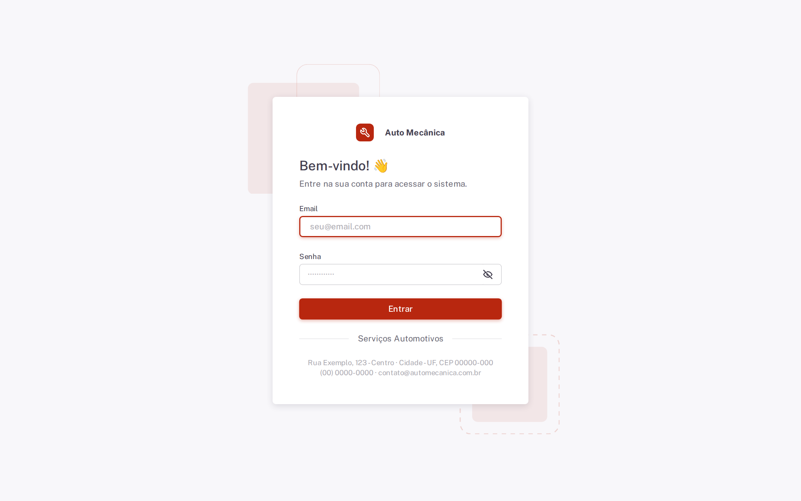
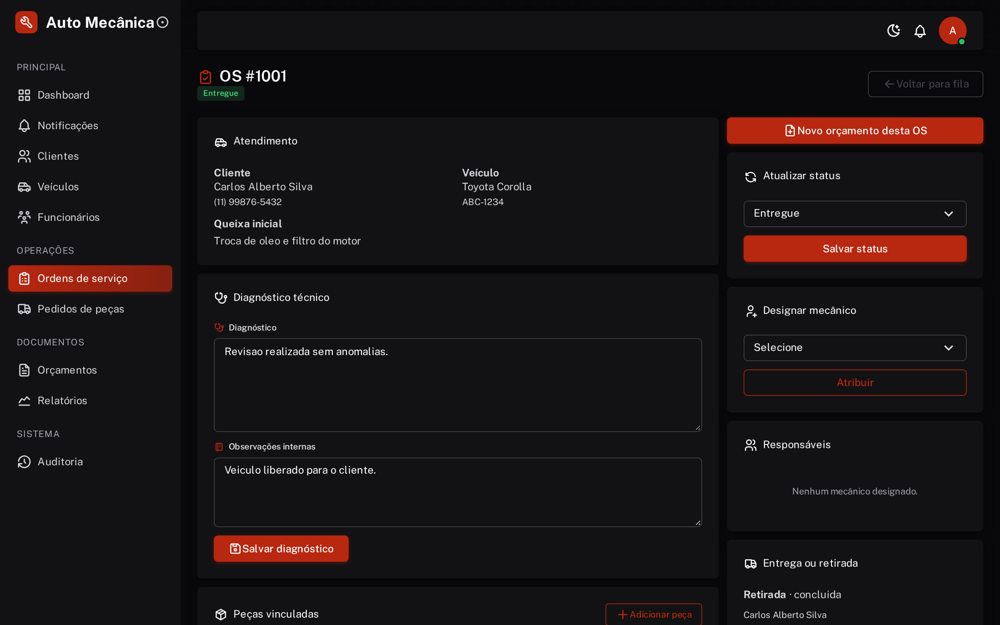

# Auto Mecânica — Sistema de Gestão de Oficina

Projeto Integrador (PI) de um sistema web para gestão de oficina mecânica.
Stack simples e funcional: **PHP (puro) + MySQL + JavaScript + HTML/CSS + Bootstrap 5**.

## Preview

| Login | Dashboard |
| --- | --- |
|  |  |

| Ordens de serviço | Detalhe da OS (tema escuro) |
| --- | --- |
|  |  |

| Orçamentos | Clientes |
| --- | --- |
|  |  |

## Funcionalidades

- **Autenticação** com perfis: administrador, secretaria, mecânico-chefe e mecânico.
- **Clientes, veículos e funcionários** (CRUD).
- **Ordens de serviço** com wizard, diagnóstico, tarefas, responsáveis,
  histórico de eventos e controle de status.
- **Pedidos de peças** com recebimento parcial e vínculo à OS.
- **Orçamentos** com itens de peça e mão de obra digitados livremente.
- **Notificações** internas.
- **Auditoria** de ações sensíveis.

## Requisitos

- **Docker** ou **Podman + podman-compose** (recomendado), ou
- PHP 8.1+ (extensões `pdo_mysql` e `mbstring`) + MySQL 5.7+/MariaDB 10.4+
  e Apache com `.htaccess` (XAMPP serve).

## Subir com Docker / Podman (recomendado)

1. Suba a stack (na raiz do projeto):

   ```bash
   docker compose up -d --build
   # ou, no Fedora com Podman:
   podman-compose up -d
   ```

2. Acesse:

   | Serviço     | URL                     |
   |-------------|-------------------------|
   | Aplicação   | http://localhost:8080   |
   | phpMyAdmin  | http://localhost:8081   |

3. O banco `mecanica` é criado e populado automaticamente a partir de
   `sql/mecanica.sql` no primeiro start (volume `db_data`).

Credenciais padrão (altere em produção, no `.env`):

```text
Usuário: mecanica
Senha:   root123
Banco:   mecanica
```

Para recriar o banco do zero: `docker compose down -v` e suba de novo.

## Instalação (XAMPP) — alternativa

1. Copie o projeto para `htdocs/mecanica`.
2. Crie um banco vazio e importe `sql/mecanica.sql` pelo phpMyAdmin.
3. Copie `.env.example` para `.env` e ajuste as credenciais
   (`DB_HOST=localhost`, `DB_USER=root`, `DB_PASS=`).
4. Acesse `http://localhost/mecanica/`.

O `.env` está no `.gitignore` — **nunca** suba credenciais para o Git.

## Credenciais de teste

Todos os usuários usam a senha **admin123**:

| Perfil          | E-mail                    |
|-----------------|---------------------------|
| Administrador   | admin@mecanica.com        |
| Secretaria      | secretaria@mecanica.com   |
| Mecânico-chefe  | chefe@mecanica.com        |
| Mecânico        | mecanico1@mecanica.com    |
| Mecânico        | mecanico2@mecanica.com    |

## Estrutura

```
config/      conexão (config/conexao.php) e carregador de .env (config/env.php)
includes/    sessão, header, sidebar, footer, helpers
pages/       módulos do sistema (um diretório por área)
api/         endpoints JSON (ex.: veículos por cliente)
css/ js/     estilos e scripts
sql/         script de criação do banco com dados de demonstração
```

## Segurança

- Senhas com `password_hash` (bcrypt).
- Prepared statements (PDO) em todas as consultas.
- Token CSRF nos formulários e endpoints de escrita.
- Controle de acesso por perfil (`exigir_papel`).
- `.htaccess` bloqueando `.env`, `.sql`, logs e acesso direto a `config/` e `sql/`.
- **Cloudflare Turnstile** no login (opcional, ver abaixo).

## Cloudflare Turnstile (anti-bot no login)

O widget já está embutido no formulário de login e o backend valida o token
via `siteverify` antes de conferir as credenciais. Enquanto `TURNSTILE_SITE_KEY`
e `TURNSTILE_SECRET` não estiverem definidos no `.env`, a verificação fica
**desativada** e o login continua funcionando.

```env
TURNSTILE_SITE_KEY=<sua-site-key>
TURNSTILE_SECRET=<sua-secret-key>
TURNSTILE_HOSTNAMES=localhost,127.0.0.1
```

Em produção, use `TURNSTILE_HOSTNAMES` apenas com o domínio real.

## Deploy em produção (checklist)

1. Suba os arquivos do projeto (inclua os `.htaccess`, `config/` e `sql/`).
2. Crie o `.env` no servidor com as credenciais **do host** e os valores do Turnstile.
3. No painel da Cloudflare → Turnstile → widget, aceite o **domínio de produção**.
4. Confirme que `https://SEU-DOMINIO/.env` retorna 403/404.
5. Importe `sql/mecanica.sql` em um banco vazio e troque as senhas de teste.
